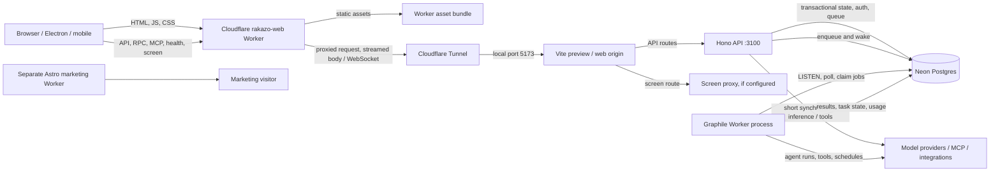

# Rakazo production audit

**Audit date:** 2026-10-24
**Scope:** read-only review of the repository, public deployment behavior, authenticated Cloudflare/Neon/GitHub metadata, provider failure metadata, CI records, current upstream, and official pricing/model documentation.
**Code snapshot:** fork `main` at `4dda60d28b5b48bd2f754922ff02088c6bc688dd`.
**Upstream snapshot:** `b89c3e7123481d81b07fbca978c64f3639b7d61e`.

No application code, production configuration, billing, database schema, or deployment was changed. No live inference or business side effect was initiated. No tests were run for this audit. Production identifiers, hostnames, secret values, prompt contents, and raw telemetry are intentionally omitted from this public document.

## Executive assessment

Rakazo has a broad, reusable product codebase and its current CI run passed typechecking, builds, unit tests, database journeys, and web E2E shards. That does not prove the deployed API or worker is running that code: the edge deployment job and production deployment job were skipped, while the live Worker version has no source revision annotation. The serving and execution revisions therefore remain unverified.

The historical inference incidents have concrete code-level causes and, for the Workers AI daily-quota retry issue, a fork fix already present in the audited source. The unresolved operational gap is whether the deployed API includes that fix. Model eligibility is not checked against the account plan, selected 403s do not advance to an eligible backup, and the current backup configuration/billing route has not been proven healthy. The Groq 413 path has no provider-specific bounded request reduction. These are reliability defects independent of the Workers plan.

The managed deployment has a separate readiness gap: the API implements database-aware `/ready`, but the edge Worker and Vite origin route only `/health`; public `/ready` and `/internal/health` requests returned the SPA shell with HTTP 200. The public `/health` response is a liveness answer, not proof that the database or worker can serve work.

The project is suitable as a foundation for business-oriented assistant teams. Bot configuration, delegation, memory, skills, integrations, schedules, approvals, browser/computer adapters, and audit/history code exist. Their production wiring and end-to-end behavior have not been proven. The managed Compose default explicitly disables the computer sandbox, so authenticated browser/terminal work must not be marketed as available until the actual production setting and provider are verified.

### Release blockers

1. **Deployed code revision is unknown.** Edge and production CI deploy jobs were skipped; the API and Graphile Worker image digest/revision were not exposed through a safe operator endpoint.
2. **Dependency scan has a critical DOMPurify advisory** in the current lockfile, plus high-risk MCP and SSRF-related findings. Fix and verify the shipped dependency graph before external launch.
3. **Provider configuration is not a safe release configuration yet.** Historical 429/403/402/413 failures, an unproven independent backup, no account-plan eligibility check, and no hard tool-call cap remain.
4. **Readiness and database backup recovery are not proven.** The edge does not route `/ready`; the managed Neon deployment has no verified Neon-specific backup and restore rehearsal.
5. **Tenant isolation, integrations, authentication, computer use, scheduled execution, and approval flows have not had production end-to-end acceptance evidence.** Some are conditional on enabled services and must be explicitly scoped for the first release.

## Evidence and limits

| Label | Meaning |
|---|---|
| **Verified in repository** | Checked against the stated fork commit, workflow/configuration files, or tests in the tree. |
| **Verified live** | Read-only cloud metadata or unauthenticated HTTP behavior was observed during this audit. No configuration was changed. |
| **Historical evidence** | Prior incident categories supplied for this audit and sanitized log metadata. It establishes that a failure occurred, not that it is still happening. |
| **Unverified** | The necessary production revision, runtime secret, account entitlement, or user-level test was not observable through safe read-only access. |

The production account and repositories were accessible through authenticated read-only tooling. Secret values were not read or copied. Cloudflare Worker settings and Tunnel health, Neon plan/compute and migration metadata, provider error categories, GitHub workflow state, and public health responses were reviewed. No production model call was made because it would consume quota and would not exercise the application’s end-to-end path.

Still required from the operator before implementation or release: redacted image tags/digests and an internal revision/readiness result for API and worker; the active Worker deployment’s source SHA; sanitized model connection/provider/model identifiers and backup ordering; whether model keys are BYOK or Gateway-billed; Neon connection endpoint mode (direct vs pooled, without host or credentials); recent Neon active-CU history; authentication/signup policy; enabled integration scopes; configured sandbox/browser provider; alert sink status; and a successful encrypted backup/restore drill record. Do not provide credential values, database URLs, customer records, prompts, or private hostnames.

## Repository, fork, and deployment revision

| Area | Finding |
|---|---|
| Fork | `main` is at `4dda60d28b5b48bd2f754922ff02088c6bc688dd`; the working tree was clean before writing this audit. |
| Upstream divergence | Current upstream is `b89c3e7123481d81b07fbca978c64f3639b7d61e`; fork is **13 commits ahead and 213 behind**, with merge base `deb415beceea1e668351e84be0f262c858ccdc30`. |
| Pull requests | No open fork PRs were returned at audit time. |
| CI on audited HEAD | Typecheck, production builds, database journeys, unit tests, native computer jobs, lint, and web E2E shards succeeded. This proves the checked-out commit in CI, not the production revision. |
| Deploy workflows | Latest `deploy-edge` validation succeeded but the edge deploy job was skipped because its enable flag was not `true`. The production deploy job was also skipped. Image publishing succeeded, but does not show that the origin pulled that image. |
| Edge runtime | The active application Worker version was created through Cloudflare tooling, but deployment metadata contained no source commit. It cannot be matched to the audited fork commit. |
| API and worker runtime | Actual image digest, tag, and source revision were not exposed by a safe public endpoint. The API and worker revisions are unknown. |
| Other CI | A trusted Playwright screenshot-gallery publishing job failed after the test jobs completed; the underlying web E2E shards succeeded. Treat this as a reporting/publishing issue, not evidence that the browser tests failed. |

**Conclusion:** source tests pass for the audited commit, but production revision parity is not established. Release verification needs an immutable source SHA attached to the edge version and API/worker image, then checked against the approved release commit.

## Actual architecture and request paths

The deployment is a hybrid edge-plus-origin design. Cloudflare serves static web assets at the edge and forwards application traffic through a Tunnel to a continuously running self-hosted origin. The API and queue worker remain Node services at that origin; the database is managed Neon Postgres.

### Verified routing behavior

- `apps/web-edge/src/index.ts` serves all non-proxied requests from Worker assets. It forwards `/api`, `/rpc`, `/mcp`, `/.well-known`, `/novnc`, and `/health` to `ORIGIN`; it streams response bodies, preserves multiple `Set-Cookie` headers, and passes WebSocket upgrades.
- `apps/web-edge/cloudflare.config.ts` binds the application Worker route and assets. The marketing site has a separate Worker in `apps/www-edge`.
- The live Tunnel had one healthy connector and forwarded to the local web origin on port `5173`; its catch-all ingress returns 404. The web origin is a Vite preview service, not the API process.
- `infra/compose/docker-compose.managed.yml` runs API, worker, and web containers; the API runs migrations before serving and removes `DATABASE_MIGRATION_URL` from its runtime environment. The worker is a separate long-running process.
- Cloudflare hides inbound origin ports and provides edge asset delivery. It does **not** remove the always-on origin, Tunnel, API, worker, or database as dependencies. The self-hosted origin and its single Tunnel connector remain availability risks.
- The Worker and origin path preserve WebSocket support in code. The request path is compatible with streamed responses/SSE, but authenticated production SSE/WebSocket soak testing was not performed.

### Readiness and deployment controls

- Live public `/health` returned HTTP 200 with the constant liveness JSON response through both edge and origin paths. This is not a readiness or dependency check.
- The API implements `/ready` as a database probe plus degraded-state check, and `/internal/health` as an operator-only endpoint that rejects forwarded requests (`apps/api/src/health.ts`).
- `/ready` is absent from the edge proxy prefixes. `/ready` and `/internal/health` returned the SPA HTML shell with HTTP 200 through the public edge and through the web origin. These responses do not reach the API readiness routes.
- Managed Compose health-checks the API using `/health` and the web service using `/`; the worker service has no Compose healthcheck. A live API readiness signal and queue-worker readiness signal are therefore not available at the deployment boundary.
- Worker observability/invocation logs were enabled, query strings were redacted, and traces were off. A production error-reporting sink (Sentry, Axiom, or OTLP) was not verified. Local container logs are bounded, which is useful for disk safety but insufficient as durable incident history.

## Cloudflare and origin configuration

| Component | Verified state | Operational implication |
|---|---|---|
| Application Worker | Asset-serving edge Worker with API proxy; `ORIGIN` is a text binding and differs from the public app origin. No commit SHA annotation. | Verify origin binding and immutable deploy revision in the operator console/CI before release; do not expose the binding value in this document. |
| Marketing Worker | Separate Astro static site Worker. | Independent deployment and rollback path. |
| Tunnel | One healthy connector; origin is local web service on port 5173. | Tunnel removes public inbound ports but a single connector/origin host remains an availability dependency. |
| Worker routes | API/RPC/MCP/screen/health prefixes are proxied; other routes are static assets. | Add and test a deliberate readiness route; avoid exposing internal details. |
| Environment | Compose has generic deployment/provider environment variables; live values were not read. | Runtime feature/provider state cannot be inferred from defaults alone. |
| Secret handling | Managed Compose defaults `SECRET_STORE` to encrypted database storage; the API gets migration credentials only during migration. | Confirm encryption keys are backed up/rotated and that each process receives only the secrets it uses. |

Cloudflare is not merely a proxy: it serves the static bundle directly at edge locations, keeps the origin off inbound public ports, and provides routing/edge observability. The app’s dynamic requests still travel to the origin. Replacing this design would trade those benefits for other operational work without addressing current inference, recovery, or single-origin failure modes. Keep the existing split for the stabilization release.

## Neon and database state

### Live metadata

- The connected Neon project is on the Free plan with a single production branch/database, PostgreSQL 18, and a fixed `0.25 CU` compute configuration (minimum and maximum are equal). That configuration has no autoscaling headroom.
- `suspend_timeout_seconds = 0` means the provider default is used; Neon documents the default as scale-to-zero after five minutes of inactivity. Zero does not mean “never suspend.”
- A read-only migration-ledger comparison found the checked-in migrations applied through `20261022200000_bot_fleet_management_default_on`; there were no failed/incomplete entries in the inspected ledger.
- The application role is a non-superuser with `BYPASSRLS` disabled and is separate from the migration/owner role. RLS is enabled on some, but not all, application tables; none of the checked tables used `FORCE ROW LEVEL SECURITY`. This setup can be sound when the app role does not own tenant tables, but it still requires tenant-isolation tests for every tenant-scoped access path.
- Live metadata showed persistent connections/listeners. `apps/worker/src/index.ts` starts a Graphile Worker host, and `packages/adapters/src/wakeup.ts` defaults its poll interval to 500 ms and uses Postgres `LISTEN`. This sustained activity can prevent Neon autosuspend. Actual weekly CU-hour history was not available in the audit evidence, so the amount of usage caused by the worker is unquantified.
- Production `DATABASE_URL` and `REALTIME_DATABASE_URL` host modes were not verified. Repository docs specify direct Neon connections because transaction pooling does not preserve `LISTEN`/`NOTIFY`, advisory locks, or transaction-local RLS context used by the app. Confirm redacted endpoint mode before changing it; do not route these sessions through transaction pooling.

### Migration and backup posture

- Managed Compose applies migrations before starting the API and then strips the migration URL from the API process. This follows the required separation between migration owner and application role.
- RLS migrations contain compatibility policies intended to allow the previous API revision during side-by-side rollout. Preserve the expand/contract rule: add first, deploy compatible code, and remove or rename only in a later release after old code is gone.
- `scripts/backup.sh`, `scripts/restore.sh`, and the production backup timer/compose scripts target local Postgres Compose. They do not constitute a Neon backup/restore routine for `docker-compose.managed.yml`.
- Free Neon currently provides a six-hour instant restore window. No Neon-specific encrypted logical backup, retention verification, or isolated restore drill was evidenced. This is a recovery gap for business records and agent state.
- `docs/deployment/cloudflare-neon.md` has an allowance-unit error: it says “100 hours” where the current Neon Free allowance is 100 **CU-hours**. Its estimate that a `0.25 CU` compute can run for about 16.7 days is consistent with 100 CU-hours, not 100 wall-clock hours. Correct the docs in a separate documentation PR.

### Cost scenarios

These are current published list rates and arithmetic scenarios, not a forecast from measured traffic. They exclude tax, self-hosted origin/VPS, offsite backup storage, monitoring/log retention, integrations, and model usage unless stated.

| Scenario | Approximate monthly platform cost | Assumptions |
|---|---:|---|
| Very light / idle | `$0` Cloudflare Workers Free + `$0` Neon Free | Fits Cloudflare free limits and Neon usage stays within 100 CU-hours, 1 GB, and the six-hour restore window. This is only plausible if the worker/background connections permit long idle periods; verify by measuring. |
| Stable edge + DB kept awake at 0.25 CU | about `$24.70` plus origin/backup/monitoring/inference | Cloudflare Workers Paid minimum `$5`; Neon Launch at 0.25 CU continuously for 730 hours is 182.5 CU-hours × `$0.106` = `$19.35`, plus up to 1 GB storage × `$0.35` = `$0.35`. |
| Moderate edge usage | `$5` base plus measured Workers request/CPU overage; Neon compute based on active hours and chosen CU size | Workers Paid includes 10 million requests and 30 million CPU milliseconds; excess use is metered. Existing Neon max is only 0.25 CU, so increasing workload needs an explicit capacity/plan decision. |
| Workers AI model usage | Usage-dependent | Workers AI includes 10,000 Neurons/day; on Paid, usage beyond that is `$0.011 / 1,000 Neurons`. The GLM candidate’s current catalog prices are `$0.0605/M` input and `$0.40/M` output tokens (for example, 100M input + 20M output ≈ `$14.05`). Actual cost depends on provider/model and context/tool-loop volume. |

Neon’s current Free plan includes 100 CU-hours and 1 GB per project; at 0.25 CU, 100 CU-hours is 400 active hours. A 24/7 worker that keeps this compute active would use approximately 182.5 CU-hours/month, exceeding the Free allowance. A week of Neon usage history and queue connection analysis should decide whether a paid compute is necessary; do not purchase a plan based on a polling assumption alone.

## Model-provider reliability audit

### Current inference path

- The Pi runtime in `packages/adapters/src/pi-runtime.ts` loads user/Space/provider connection settings, applies configured model and explicit backups, streams completions, dispatches tool calls, enforces run leases, and has bounded same-model retry behavior.
- The Cloudflare adapter in `packages/adapters/src/cloudflare-ai-gateway.ts` sets SDK retries to zero because Cloudflare uses HTTP 429 for both temporary capacity and exhausted daily allowance. `packages/adapter-kit/src/model-errors.ts` excludes the daily-quota category from transient retry. This fork change is already committed in `79c32a7` and has regression coverage in `packages/adapters/src/pi-runtime-fallback.test.ts`.
- The current logic can move to a configured backup after a provider error. There is no cross-run quota circuit breaker, so each new user run may still make one call to a known-exhausted primary. Whether the historical burst was duplicate SDK retries or separate runs cannot be determined from sanitized failure metadata alone.
- Retryability is not provider-normalized end-to-end. A generic 403 is not treated as provider-unavailable except one Kimi usage-window case, so a model-plan eligibility failure will not reliably progress to an eligible configured backup. Conversely, not every 403 is safe to fail over: invalid credentials and policy denial must stay actionable rather than be hidden.
- The generic deployment fallback does not prove that the fallback has a separate credential, billing route, quota, or model capability. A second Workers AI model under the same account is not an independent fallback for an exhausted account-wide daily quota.
- Context selection in `packages/adapters/src/context-selection.ts` counts serialized bytes and framing rather than using each model’s tokenizer. It is conservative for many cases but cannot establish the provider’s token accounting. `packages/adapters/src/pi-runtime-limits.ts` and the runtime reserve output space, with output capped at a fraction of the model context; configured reasoning can still be large. The Groq 413 is a per-account request-token/TPM limitation per the supplied incident evidence; the exact provider payload and model limit were not available for confirmation.
- `MAX_TOOL_CALLS_PER_TURN` defaults to no explicit limit when unset, and managed Compose passes an empty default. There is no identified hard per-run/provider/team spend cap. This creates cost and runaway-loop risk for persistent agents.
- The runtime has a stream timeout and one configurable generic retry by default; Cloudflare overrides retries. Tests cover fallback/quota handling, context selection, truncation, streaming, and tool dispatch. Provider live conformance, cancel/uncertain-side-effect recovery, near-cap load, and cost-budget exhaustion remain untested.

### Failure analysis

| Failure | Verified cause and code path | What remains uncertain | Smallest durable correction | Existing and missing acceptance evidence |
|---|---|---|---|---|
| Workers AI `429` / historical code `4006` | Historical sanitized logs show daily-allocation exhaustion. The fork’s `79c32a7` change disables nested SDK retries for the Cloudflare adapter and marks daily quota non-transient so it does not repeat the same request. Existing path: runtime → Cloudflare adapter → provider classification → configured backup. | Current Cloudflare public docs list daily allowance exhaustion as internal code `3036`, while supplied historical records used `4006`; classify by HTTP status plus structured message/known codes rather than only one integer. Production API revision is unknown. No cross-run circuit breaker; logs did not prove whether repeated calls were retry loops or separate user runs. | Verify the deployed revision contains `79c32a7`; add provider-version-tolerant quota classification and a bounded per-credential/model cooldown only if post-fix evidence shows fresh runs continue hitting a known exhausted quota. Do not retry quota exhaustion. | Existing `pi-runtime-fallback.test.ts` covers quota no-retry/backup. Add deterministic adapter tests for both quota signatures, zero additional primary attempts after exhaustion within one run, one explicit backup attempt, and actionable terminal state. Acceptance: simulated quota emits at most one primary request, no same-provider retry, and either a tested independent backup succeeds or the run visibly fails with quota/reset guidance. |
| Workers AI `403` / code `5035` | Current Cloudflare docs define 5035 as a model requiring a Workers Paid plan. Fork model choices do not verify account entitlement. Generic model-plan 403 is not uniformly classified to advance a backup. GLM-4.7-Flash is currently listed as Free-eligible, has a 131,072 context window, function calling, and reasoning, but that is catalog evidence only. | Whether the production account is Workers Free/Paid and whether configured model IDs are eligible was not verifiable from the safe account metadata. Provider errors may also mean invalid credentials or policy restrictions. | Validate selected model capability/eligibility during connection setup when provider metadata allows; encode a narrow typed `model_not_eligible` error for code 5035; only advance to an explicitly configured compatible backup. Keep auth/policy 403 terminal. | Add tests distinguishing plan-ineligible 5035, bad credential 403, and model-specific unsupported tool capability. Acceptance: unavailable model rejected before normal use where possible; otherwise one visible failure plus a single eligible backup attempt, no repeated 403 loop. |
| AI Gateway `402` | A historical 402 was observed through AI Gateway for a request logged as provider OpenAI. Historical incident notes attribute it to a zero prepaid balance. Current Gateway metadata showed Workers AI billing mode `postpaid`, BYOK-only disabled, and logging enabled. | The exact request’s credential route is unresolved: AI Gateway BYOK/provider billing versus Cloudflare Unified Billing cannot be inferred from the status alone. The current postpaid setting does not prove the historical request used or exhausted prepaid Unified Billing. | Trace a sanitized request from selected connection → gateway route → billing mode → provider status. Configure the chosen provider route explicitly, validate balance/credential during setup where supported, and classify provider billing failure as non-retryable with a clear message. Do not buy credits or repeat requests until this route is established. | Add offline tests for 402 classification and fallback rules; acceptance: the user sees which configured connection/provider needs attention, the failed route is not retried, and a backup is attempted only when independently credentialed and tested. |
| Groq `413` | Per supplied evidence, the request exceeded the account’s token limit. The runtime context selector budgets approximate serialized context; generic 413 is non-retryable and does not apply Groq-specific payload reduction. | Exact request, account TPM limit, tokenizer, and provider response details are unavailable; the error may combine request size and rate-window budget. | Port/adapt upstream `7fb9beef`: provider-specific request budget, output reservation and a single bounded context shrink/retry with headroom. Preserve tool-call history and avoid re-sending large prior tool output. | Add deterministic context-budget tests around limits, preserving tool history, and testing one retry only. Acceptance: simulated Groq 413 reduces the current request once to below the configured budget; a second 413 returns an actionable error without a loop. |
| Missing computer/browser capability | Managed Compose defaults `SANDBOX_PROVIDER` to `none`; docs describe computer use as off until configured. `/novnc` has a proxy route, and provider adapters exist for several sandbox services. | Actual production override, browser provider, sandbox credentials/network boundary, browser persistence, authentication handoff, and MFA behavior were not verified. | For the minimum release, explicitly declare browser/terminal capability unavailable if the provider is not configured. Later enable one supported sandbox provider behind outbound/network/user isolation, secure credential handoff, visible action approval, and an expiry boundary. | No live browser/login test was performed. Acceptance requires a disposable account, persistent session, secret redaction, MFA handoff, origin allowlist/egress restriction, approval before write actions, teardown, and a failure/recovery drill. |

### Candidate model and production qualification

`@cf/zai-org/glm-4.7-flash` is the best current **qualification candidate** for an economical Workers AI default: Cloudflare currently lists it as Free-eligible, with tool/function calling, reasoning, a 131,072-token context window, and per-token pricing. This is evidence of provider catalog support, not proof that Rakazo’s adapter, tool schemas, multi-step business tasks, or runtime reliability work with it. It is **not yet a production-ready recommendation**.

No independent fallback is currently validated. A prudent first configuration is one GLM-4.7-Flash primary after the matrix below passes, plus one separately credentialed provider/model whose context, tools, billing, rate limits, and recovery have passed the same tests. If no independent route can be provisioned, fail clearly when primary quota is exhausted instead of presenting a same-account model as a fallback.

Required conformance matrix in staging:

1. Ordinary chat and a multi-turn conversation with bounded context.
2. Multi-step reasoning with a versioned evaluation rubric and reviewed examples.
3. Tool invocation, structured arguments, tool result, and final response.
4. Agent-to-agent delegation, result return, cancellation, and hop-limit behavior.
5. Simulated transient provider failure; bounded retry and tested alternate provider.
6. Quota exhaustion for each provider; no retry loop and clear terminal or fallback outcome.
7. Context just below and above provider request limits, including large tool schemas and output reservation.
8. Interrupted action after dispatch but before acknowledgement; reconciliation/idempotency must prevent duplicate writes or clearly mark uncertain outcome for review.
9. Streaming client disconnect/cancellation and provider timeout; no orphan run that appears successful.
10. Cost/usage reporting and finite per-turn tool-call limit.

For natural-language quality, use an opt-in, provider-neutral judge with an explicit versioned rubric calibrated on human-reviewed samples. Keep judge cost separate and an errored judge result unqualified; retain deterministic assertions for tool effects and structured contracts.

## Agent capability audit

The repository has code for most desired team primitives. “Implemented” below means code paths and tests exist; it does not imply the feature was enabled or verified in this production account.

| Capability | Repository evidence | Production status / launch condition |
|---|---|---|
| Create/configure specialist bots | Bot/Space RPCs, DB records, settings, model selection. | Production CRUD and successful run not exercised in this audit. Include in core smoke test. |
| Agent-to-agent messages and delegation | Child-bot/team-chat runtime, hop limits, job execution. | End-to-end coordinator-to-specialist workflow unverified. Upstream has a parallel approval continuation fix worth integrating. |
| Shared and isolated memory | Memory package and per-bot/Space provider interfaces. | Active provider and retention settings unknown. Test tenant/Space boundaries and deletion/retention. |
| Skills and reusable workflows | Skill storage/runtime plus teach-recording modules. | No reviewed business workflow catalog or end-to-end teach/replay result was inspected. Keep deterministic steps explicit and versioned. |
| MCP and external apps | MCP adapters, integrations catalog, Composio/Pipedream paths. | Enabled connections, OAuth grants, scopes and refresh are unknown. Default `MCP_STDIO_ENABLED=false`. Remote MCP OAuth refresh and tool-result trust need fixes/tests. |
| Permissions and approvals | Approval records, action policies, security events, audit/history code. | Full UI→API→worker continuation and parallel approval paths not verified. Preserve approval for external writes. |
| Scheduled routines | Schedule/job code and Graphile worker reconciliation. | Worker revision and a production scheduled execution are unverified. Core operational capability requires a canary. |
| Browser authentication and sessions | Browser/computer adapters and credential storage/handoff modules. | Default sandbox is `none`; persistent session, login, MFA, and browser credential scoping are not verified. Treat unavailable until proven. |
| Secrets | Encrypted secret store default and optional Infisical adapter; runtime secrets separated by service. | Active secret backend, rotation/key recovery, and redaction at every provider/log boundary unknown. |
| Run history/outcomes | Job, task, usage, approval, and audit persistence in code/schema. | Retention and user-visible failure/outcome behavior not validated against live execution. |

### Representative team suitability

- **Coordinator:** technically supportable through bots, child-task orchestration, approvals, and run history. Needs clear finite hop/tool budgets, delegate completion semantics, and an escalation path.
- **Marketing:** research and campaign analysis fit chat, web/search tools, skills, memory, and scheduled work. External publishing must require approval.
- **Sales:** lead qualification is supportable; CRM writes require a configured least-scope integration and approval. No verified CRM connection or production workflow was observed.
- **Operations:** scheduling/follow-ups fit the routine and integration code. Calendar/task writes require idempotency, approval policy, and a job recovery canary.

There is no evidence of a one-click “business team” template or proven out-of-the-box CRM workflow. The minimum release should prove one coordinator and two specialists in a safe read-only workflow first, then one explicitly approved external write. Do not make a broad multi-agent feature launch a prerequisite to restoring reliability.

## Security and operational readiness

### Dependency and network security

`pnpm audit --prod --json` reported **97 advisories across 24 production dependency paths** (1 critical, 53 high, 34 moderate, 9 low). This is a dependency graph finding, not proof of runtime exploitation. The critical path is DOMPurify older than the fixed `3.4.17`; current upstream commit `1023b661` pins `3.4.17`. The remote MCP SDK is `1.30.0` in the fork; the advisory-fixed line is `1.31.0` or later, and the package is used for remote MCP. Review the complete advisory report in a private maintenance channel, then patch the lockfile and verify built bundles before launch.

The fork’s `packages/adapters/src/network-address.ts` does not cover all link-local/cloud metadata cases identified during review, including IPv4-mapped IPv6 normalization. Upstream `bb08548b` adds address-form protections. This is a launch blocker for unrestricted URL fetch, remote MCP endpoints, or browser/computer egress until backported with deterministic SSRF tests. Upstream `822b8797` also scopes requested browser credentials to the page’s site; adopt before enabling browser login. Upstream `9f4f42f2` handles persistence of rotated OAuth grants and should be integrated with a refresh test.

Upstream `eefa32a2` adds sanitization for invalid Postgres text/structured JSON inputs and preservation of prototype-like keys as data. It is a DB-write robustness fix, not a log-redaction fix; adopt where compatible and test malformed inputs.

### Identity, isolation, approvals, and data

- Database inspection confirmed the application runtime role is not a superuser, has `BYPASSRLS=false`, and is distinct from the migration role. RLS protects some but not all tables, and no `FORCE RLS` is configured. Prove tenant isolation through authenticated API tests, including background jobs and raw query paths; do not infer complete coverage from role flags alone.
- Public registration policy, account recovery, MFA/SSO requirements, and current auth provider settings are not confirmed. Verify `SIGNUPS_ENABLED` or equivalent policy and email/reset flows before opening access beyond named operators.
- The managed Compose secret store defaults to encrypted DB storage. Confirm encryption-key backup and rotation procedure; losing the encryption key can make saved provider credentials irrecoverable. Do not move secrets into prompts, task history, or logs.
- Treat remote MCP output as untrusted input. Keep tool permissions scoped to the active Space/user, redact credentials, prevent secret forwarding, and require approval for external writes, messaging, publishing, and financial actions.
- The upstream change that allows all action execution without confirmation is rejected for default production behavior. If later needed, design narrow per-action grants with audit trail, revocation, and visible owner controls.
- The sandbox default is disabled. If enabled, verify process/container boundary, filesystem isolation, outbound policy, credential mounting, cleanup, and command allowlists before allowing terminal or authenticated browser use.
- Live AI Gateway logging was enabled. Current Cloudflare docs state log records may contain prompt and response payloads; send `cf-aig-collect-log-payload: false` or disable payload capture at the gateway while retaining only required metadata. This audit did not inspect successful prompt payloads and does not assert that they were stored.
- No confirmed durable alert/error sink, tested retention policy, or restore drill was evidenced. These are release readiness gaps for business workflows.

### Launch blocker summary

| Blocker | Why it blocks | Evidence required to clear |
|---|---|---|
| Production revision parity | Cannot tell whether the quota fix, security fixes, or approved app code are running. | Source SHA and immutable image/version digest for edge, API, and worker all match the approved release record. |
| Critical/high dependency and SSRF exposure | A reachable HTML sanitizer, remote MCP library, and unhandled address forms create avoidable attack surface. | Fixed dependency graph; review which code paths are reachable; deterministic regression tests pass. |
| Readiness route is not routed; worker health absent | Edge and web health answers can claim HTTP 200 while API readiness or jobs fail. | API readiness is correctly proxied and deployment gates check API, DB, and worker; fault injection returns non-ready status. |
| No verified Neon backup/restore | Six-hour restore is not an independent retained backup and recovery was not rehearsed. | Encrypted logical backup stored separately and successful isolated restore with documented RPO/RTO. |
| No safe model route proven | Quota, plan eligibility, billing route, and backup remain partially unverified. | Primary and independent backup pass conformance matrix; quota/402/403/413 outcomes are bounded and visible. |
| Tenant/auth/action policy not end-to-end tested | Business records and connected-app writes need isolation and explicit authorization. | Tenant-isolation/API approval test evidence; registration and recovery policy signed off; no unapproved external write. |

## Upstream comparison and integration strategy

The fork is 13 commits ahead and 213 behind current upstream. A blind merge would mix hundreds of changes with intentional Cloudflare/Neon deployment and platform work and make the security/reliability fixes hard to review.

| Classification | Changes |
|---|---|
| **Adopt immediately** | `1023b661` DOMPurify pin; `bb08548b` address/SSRF normalization; `822b8797` browser credential site scoping before browser use; `9f4f42f2` persist OAuth rotated grants; `eefa32a2` Postgres text/JSON sanitization; `aad3633c` worker recovery/backup safety after checking self-hosted assumptions. Also update the fork’s direct MCP SDK dependency to a fixed release. |
| **Adopt selectively** | `fcc86da6` token-budget estimator; `0dead70e` provider request/tool schema normalization; `946d6d1d` provider-limit/fallback error classification; `7fb9beef` bounded Groq request reduction and provider output reservation; `85c16047` continuation of approved calls when parallel actions need approval. These overlap the Pi/Cloudflare runtime and need narrow adapters plus fork-specific tests. |
| **Defer** | Unrelated UX, provider catalog, Android/native, marketing, and broad feature work that does not fix a release blocker. Revisit once the core release is stable. |
| **Reject or redesign** | `c436c7f1` broad “run actions without asking” behavior as a default. Business messaging, CRM, calendar, and publishing writes must remain approval-gated unless a narrowly scoped, revocable policy is explicitly designed and audited. |

### Recommended merge approach

Use **small targeted backports/cherry-picks**, one concern per PR, for self-contained security fixes. Hand-port the provider/runtime fixes that overlap Cloudflare adapter behavior, accompanied by offline deterministic tests. Record upstream commit SHA and any adaptation in each PR. Do not merge the full upstream branch or reset/rebase away the fork’s 13 intentional changes.

Preserve the edge Worker, Tunnel/Neon Compose topology, Cloudflare AI direct adapter and the `79c32a7` quota retry correction. Before each backport, compare its file scope and migration behavior with the fork. If an upstream migration drops/renames data or changes RLS, split it into add-only compatible migrations and a later cleanup release. Use staging CI before touching production.

## CEO summary

1. **Why isn’t Rakazo reliable today?** The model configuration has hit exhausted daily quota, ineligible model plans, an unresolved Gateway/provider billing path, and oversized Groq requests. The source now contains a fix for repeated same-call Workers AI quota retries, but the deployed API revision is unknown. The live edge returns a green liveness page where readiness should be checked, and background/database recovery is not evidenced.
2. **What must be fixed first?** Prove the deployed source revisions; close the dependency/SSRF issues; configure and test one eligible primary plus an independent backup (or clear failure); cap tool loops; route readiness correctly; and prove a Neon restore.
3. **What functionality is actually missing?** The repo contains most assistant/team code, but production availability is unproven. Browser/computer functionality is disabled by the managed default unless overridden. No production CRM/team template or tested end-to-end scheduled team workflow was demonstrated.
4. **What can we reuse from upstream?** Useful security fixes for DOMPurify, SSRF, browser credential scoping, OAuth token refresh, malformed DB values, plus provider budgeting/normalization, approval continuation, and worker recovery. Apply as focused backports, preserving the fork’s deployment adaptations.
5. **What would Cloudflare Workers Paid fix—and not fix?** It enables models restricted on Free and allows Workers AI usage beyond 10,000 Neurons/day at metered rates. It does not fix application retry/fallback defects, an unfunded Gateway/OpenAI route, Groq 413 handling, database/readiness gaps, a failed origin, or disabled computer capability. It adds a `$5/month` Workers base before any overage/model usage.
6. **Can this architecture support AI business teams?** Yes, as a foundation: it already has bots, delegation, memory, skills, integrations, jobs, approvals, and history. Reliability, security, and tested integration/browser wiring need to precede expanded autonomy.
7. **Minimum viable release scope?** Authenticated chat, saved bots, one coordinator delegating to two specialists, persisted memory/task history, one tested read-only external integration, one approved write action, bounded model usage, and one scheduled canary. Browser automation remains off unless the sandbox/security gate passes.
8. **Approximate ongoing costs?** Best case remains within Cloudflare and Neon free allowances. A continuously active 0.25-CU Neon compute plus Cloudflare Workers Paid is about `$24.70/month` before origin, backup, observability, integration and inference costs. GLM-4.7-Flash’s published token rates imply about `$14.05` for 100M input + 20M output tokens. Actual usage must be measured; the current always-on Graphile worker may push Neon beyond its free CU-hours.
9. **Precise implementation order?** (1) revisions/dependency/SSRF/OAuth/security, (2) model eligibility/quota/fallback and Groq budgets, (3) readiness/worker health and Neon usage/backup, (4) scheduled jobs, memory, integrations, approvals and team smoke tests, (5) sandbox/browser only if selected and isolated, (6) staging regression, restore drill, monitoring, rollout and rollback rehearsal.
10. **What proves production is ready?** Edge/API/worker source SHAs match the release; CI and provider conformance matrix pass; fault injection produces bounded actionable errors; tenant isolation and approvals pass; the scheduler completes and recovers a canary; `/ready` fails when DB/API is unhealthy; a separate encrypted Neon backup restores in isolation; alerts fire on induced failures; and a controlled rollout/rollback is documented and verified.

## Sources

Repository evidence is referenced by path above. External model, pricing, logging, and Neon behavior were checked against official vendor documentation on 2026-10-24:

- [Workers AI pricing and daily allocation](https://developers.cloudflare.com/workers-ai/platform/pricing/)
- [Workers AI error codes](https://developers.cloudflare.com/workers-ai/platform/errors/)
- [GLM-4.7-Flash model card](https://developers.cloudflare.com/workers-ai/models/glm-4.7-flash/)
- [Workers Paid pricing](https://developers.cloudflare.com/workers/platform/pricing/)
- [Models restricted on Workers Free](https://developers.cloudflare.com/changelog/post/2026-07-28-models-require-workers-paid/)
- [AI Gateway payload logging controls](https://developers.cloudflare.com/ai-gateway/observability/logging/)
- [AI Gateway Unified Billing](https://developers.cloudflare.com/ai-gateway/features/unified-billing/)
- [Neon Free plan limits](https://neon.com/blog/neon-free-plan-1-gb-per-project)
- [Neon endpoint autosuspend and background activity](https://neon.com/docs/manage/endpoints/)
- [Neon Launch compute pricing](https://neon.com/blog/major-compute-price-reduction-on-neon)
